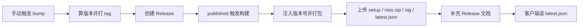

## 产品概述

把现在的「本地手动打包 + 手动同步 4 处版本号」升级为一条自动化发布链路：版本号由 Git 标签统一决定，发布动作触发云端打包，产物与更新清单自动挂到 Release，客户端能自己发现新版本并完成下载安装。用户只需在 GitHub 上点一次按钮或直接建 Release。

## 核心功能

**版本号体系**
- 以 `vMAJOR.MINOR.PATCH` 标签作为全系统唯一版本来源，不再手工改多处
- 提供一条命令完成发版：选择 patch / minor / major，自动算出下一个版本、提交、打标签、创建 Release
- 人工直接在 GitHub 建 Release 并写更高标签时，同样生效，天然支持跳版本

**自动打包发布**
- Release 发布后自动触发云端构建，产出安装包、更新包与签名文件
- 构建结果自动回挂到同一个 Release，无需人工上传
- 构建失败不污染 Release，可重跑

**Release 文档自动补充**
- 自动生成「自上一版本以来的变更」列表
- 自动追加安装包名称与体积、校验值、系统要求、自动更新说明、更新清单地址

**应用内更新**
- 设置页新增「关于与更新」区块：显示当前版本、手动检查、发现新版本时展示版本号与更新说明
- 下载过程显示百分比进度，完成后可直接重启进入新版本
- 启动后静默检查一次，有更新时以轻提示告知，不打断当前操作
- 安装前自动停止代理并还原系统代理，避免升级过程中断网或留下死代理

**质量门禁**
- 提交与合并时自动跑前端构建、静态检查与单元测试，构建不过不发版


## 技术栈

- CI/CD：GitHub Actions（`windows-latest` runner，公开仓库免费）
- 构建动作：`tauri-apps/tauri-action@v0`
- 应用内更新：`tauri-plugin-updater` 2.x + `tauri-plugin-process` 2.x
- 运行时依赖：`oven-sh/setup-bun@v2`、`dtolnay/rust-toolchain@stable`、`Swatinem/rust-cache@v2`
- 版本注入：Node ESM 脚本（用 bun 执行），只改 `[package]` 段版本，避免误伤依赖版本

## 实现方案

### 版本号体系

**唯一来源**：Git 标签 `vX.Y.Z`。仓库内三份清单文件降级为「构建产物」，由脚本写入。

`scripts/set-version.mjs <version>` 做三件事：

1. 校验入参符合 `MAJOR.MINOR.PATCH`（拒绝 `v` 前缀与预发布标签，统一在调用方剥离）
2. `package.json` / `src-tauri/tauri.conf.json` 走 JSON 解析与序列化，保留 2 空格缩进
3. `src-tauri/Cargo.toml` 按行扫描，只在 `[package]` 段内替换第一个 `version =`，不改依赖版本

`TitleBar.tsx` 的硬编码 `v0.1.0` 改为运行时读取：`useAppStore.init()` 里调 `@tauri-apps/api/app` 的 `getVersion()`，浏览器预览回落到 `0.1.0`，存入 store 的 `version` 字段，TitleBar 消费。这样「4 处硬编码」彻底收敛为「1 个运行时来源」。

**递增规则**（`bump.yml`，`workflow_dispatch`，输入 `level: patch|minor|major`）：

- 取当前最新 tag（`git describe --tags --abbrev=0`，无 tag 时视作 `0.0.0`）
- 按 level 计算下一个版本，跳过已存在的 tag（幂等保护）
- 跑 `set-version`，提交 `chore: release vX.Y.Z`，打 tag 并推送
- `gh release create vX.Y.Z --generate-notes`，由 `release.published` 接管后续构建

人工路径：直接在 GitHub UI 建 Release，标签写 `v0.3.0` 即可绕过 bump，版本号以标签为准。

### 发布流水线

**触发点**：`release: types: [published]`，从 `github.event.release.tag_name` 取版本。这是用户明确要的入口，也让「人工建 Release」与「bump 自动建 Release」共用同一条构建链。



**`release.yml` 关键点**：

- `permissions: contents: write`，否则无法回挂资产
- `actions/checkout` 指定 `ref: ${{ github.event.release.tag_name }}`，确保拿到标签对应提交
- `tauri-action` 传 `releaseId: ${{ github.event.release.id }}` 与 `includeUpdaterJson: true`，直接向已存在的 Release 追加资产，不再新建
- 构建前跑 `set-version`，用标签版本覆盖三份清单；`bun install --frozen-lockfile` 保证依赖锁定
- 签名密钥经 `env` 注入 `TAURI_SIGNING_PRIVATE_KEY` / `TAURI_SIGNING_PRIVATE_KEY_PASSWORD`，不落盘

**Release 文档补充**（构建成功后一步，`shell: bash`）：

1. 调 `POST /repos/{owner}/{repo}/releases/generate-notes` 拿标准变更列表
2. 拼装固定章节：安装包名与字节数、SHA256、系统要求（Windows 10 1809+ 与 WebView2）、自动更新说明、`latest.json` 地址
3. `gh release edit` 覆盖正文，保留标签与标题

失败处理：`release.yml` 任一环节失败时用 `if: failure()` 给 Release 追加一条「构建失败，修复后可在 Actions 页面重跑」的说明，避免用户下载到空 Release。

### 应用内更新

**Rust 侧**（`src-tauri/src/lib.rs`）：

```text
.plugin(tauri_plugin_updater::Builder::new().build())
.plugin(tauri_plugin_process::init())
```

`tauri.conf.json` 增加：

- `bundle.createUpdaterArtifacts: true`，产出 `.nsis.zip` 与 `.sig`
- `plugins.updater.endpoints: ["https://github.com/Gort/NanoShadowrocket/releases/latest/download/latest.json"]`
- `plugins.updater.pubkey`：由 `bunx tauri signer generate` 生成的公钥

`capabilities/default.json` 追加 `updater:default` 与 `process:allow-restart`。

**前端分层**（遵循仓库既有约定：纯逻辑进 `lib/`，状态进 store，组件只渲染）：

- `src/lib/update.ts`：包装 `check()` / `downloadAndInstall()` / `relaunch()`，把插件错误归一化成可读中文，浏览器预览模式返回 `null` 而非抛错
- `src/store/useUpdateStore.ts`：持有 `phase`（idle / checking / available / downloading / ready / error）、`version`、`notes`、`progress`、`error`，导出 `check(silent)`、`install()`、`restart()`
- `src/components/UpdatePanel.tsx`：渲染在设置页新增的「关于与更新」`Group` 内，复用现有 `SettingRow` / `Button` / `Switch` 与 color token，不引入新设计语言

**关键顺序（必须实现）**：`install()` 先判断代理是否运行，运行中则先调 `stop_proxy` 等后端返回，再开始下载安装。原因是 Windows 升级通过 NSIS 覆盖安装，进程被强杀会跳过 `ExitRequested` 的还原逻辑，留下指向已关闭端口的系统代理与环境变量。

**静默检查**：`App.tsx` 初始化完成后 `setTimeout` 5 秒调 `check({ silent: true })`，仅在 `isTauri` 时执行；有更新走 `toast` 轻提示，失败不打扰用户。

**进度反馈**：`downloadAndInstall` 的 `onEvent` 拿到 `Started` / `Progress` / `Finished`，把 `contentLength` 与 `chunkLength` 累加成百分比写入 store。安装完成后按钮变为「立即重启」。

### 质量门禁

`ci.yml`：`push` 到 main 与所有 PR 触发，跑 `bun install --frozen-lockfile` + `bun run build` + `cargo fmt --check` + `cargo clippy --lib --tests` + `cargo test --lib`。与 `AGENTS.md` 第 10 节「提交前至少跑」的四条命令完全对齐，保证 CI 与本地一致。

## 实施注意事项

- **本地构建副作用**：开启 `createUpdaterArtifacts` 后，本地 `bun run tauri build` 不带私钥会直接失败。需要在 `AGENTS.md` 写明两条出路：临时覆盖配置 `--config '{"bundle":{"createUpdaterArtifacts":false}}'`，或本地设置签名环境变量。
- **私钥不可再生**：公钥一旦随版本发布，老客户端只认它。私钥丢失等于断掉所有已安装用户的升级路径，必须在文档里用醒目段落要求备份，并禁止提交进仓库。
- **`releases/latest` 不包含预发布版**：若将来要发 beta，需要改用固定 URL 或单独的 pre-release 通道，`latest.json` 的地址要跟着换。
- **GitHub CDN 缓存**：`latest.json` 存在约 5 分钟缓存，刚发版后立刻检查可能仍返回旧版本，属于正常现象，不要误判为 bug。
- **`bump.yml` 的提交会绕开门禁**：它直接推送 main，因此必须在打标前跑一次 `bun run build` 与 `cargo test`，或改成「PR + 合并后打标」，避免把坏代码发出去。
- **仓库尚未初始化**：当前目录不是 git 仓库，需要先建远端、`git init`、首次提交并推送。`.gitignore` 已正确忽略 `src-tauri/target` 与 `node_modules`，不会误传 15000+ 构建产物。
- **单实例插件与更新安装的交互**：更新安装期间若用户手动再启动 exe，会被单实例插件拦成「唤起主窗口」，属预期行为，无需额外处理。

## 目录结构

```
.github/
└── workflows/
    ├── ci.yml          # [NEW] push 与 PR 的质量门禁：前端构建、cargo fmt/clippy/test，与 AGENTS 第 10 节命令一致
    ├── release.yml     # [NEW] release.published 触发；注入 tag 版本、tauri-action 打包上传、补充 Release 文档、失败回写说明
    └── bump.yml        # [NEW] workflow_dispatch 选 patch/minor/major；算版本、跑脚本、提交、打 tag、建 Release

scripts/
└── set-version.mjs     # [NEW] 版本注入。校验 semver，写 package.json / tauri.conf.json / Cargo.toml（仅 [package] 段）

src/
├── lib/
│   └── update.ts       # [NEW] updater 封装：check / downloadAndInstall / relaunch，错误归一化，预览模式安全降级
├── store/
│   ├── useUpdateStore.ts   # [NEW] 更新状态机：phase / version / notes / progress / error，check(silent) / install() / restart()
│   └── useAppStore.ts      # [MODIFY] 增加 version 字段，init 时调 getVersion()，供 TitleBar 与关于区块使用
├── components/
│   ├── UpdatePanel.tsx # [NEW] 设置页「关于与更新」区块：当前版本、检查更新、更新说明、进度条、重启按钮
│   └── TitleBar.tsx    # [MODIFY] 删除第 79 行硬编码 v0.1.0，改读 store.version
├── pages/
│   └── SettingsPage.tsx    # [MODIFY] 新增「关于与更新」Group，挂载 UpdatePanel
└── App.tsx             # [MODIFY] 初始化后延迟 5 秒静默检查更新（仅 Tauri 环境）

src-tauri/
├── Cargo.toml          # [MODIFY] 增加 tauri-plugin-updater / tauri-plugin-process 依赖，repository 填 GitHub 地址
├── tauri.conf.json     # [MODIFY] bundle.createUpdaterArtifacts、plugins.updater.endpoints 与 pubkey
├── capabilities/
│   └── default.json    # [MODIFY] 追加 updater:default、process:allow-restart
└── src/
    └── lib.rs          # [MODIFY] 注册 updater 与 process 插件

docs/
└── RELEASE.md          # [NEW] 发版手册：密钥生成与备份、Secrets 配置、两条发版入口、常见故障

README.md               # [MODIFY] 特性列表与「更新」章节，说明应用内更新与自动检查
AGENTS.md               # [MODIFY] 第 11 节改写：版本号单一来源、CI 发版、本地构建需密钥的副作用
```

## 关键接口

`src/lib/update.ts` 的对外契约（供 store 调用，不给实现）：

```text
type UpdatePhase = "idle" | "checking" | "available" | "downloading" | "ready" | "error";

checkForUpdate(): Promise<{ version: string; notes: string | null } | null>
downloadAndInstall(onProgress: (percent: number) => void): Promise<void>
relaunchApp(): Promise<void>
currentVersion(): Promise<string>
```

## 需要用户在执行阶段配合的动作

1. 本地执行 `bunx tauri signer generate -w ~/.tauri/nano.key`，把输出的公钥交给实现方填入配置，私钥内容与密码填入 GitHub Secrets
2. 在 GitHub 仓库 Settings → Secrets 添加 `TAURI_SIGNING_PRIVATE_KEY` 与 `TAURI_SIGNING_PRIVATE_KEY_PASSWORD`
3. 确认本机 Git 凭据或 `gh auth login` 已完成，否则首次推送会失败


## Agent Extensions

### MCP
- **GitHub**
  - Purpose: 创建公开仓库 `NanoShadowrocket`，并在流水线搭建完成后核对仓库结构、Release 与 Actions 状态
  - Expected outcome: 远端仓库存在且与本地首次提交一致；发布工作流能在 Actions 中正常触发并产出 Release 资产
