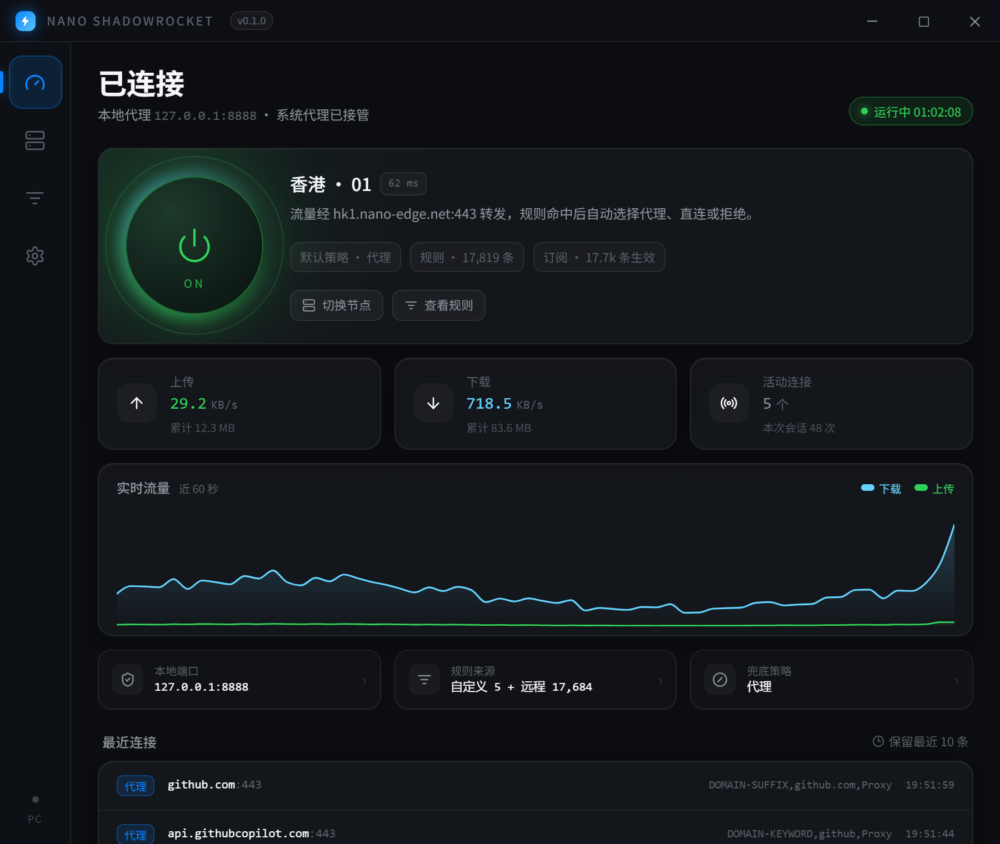
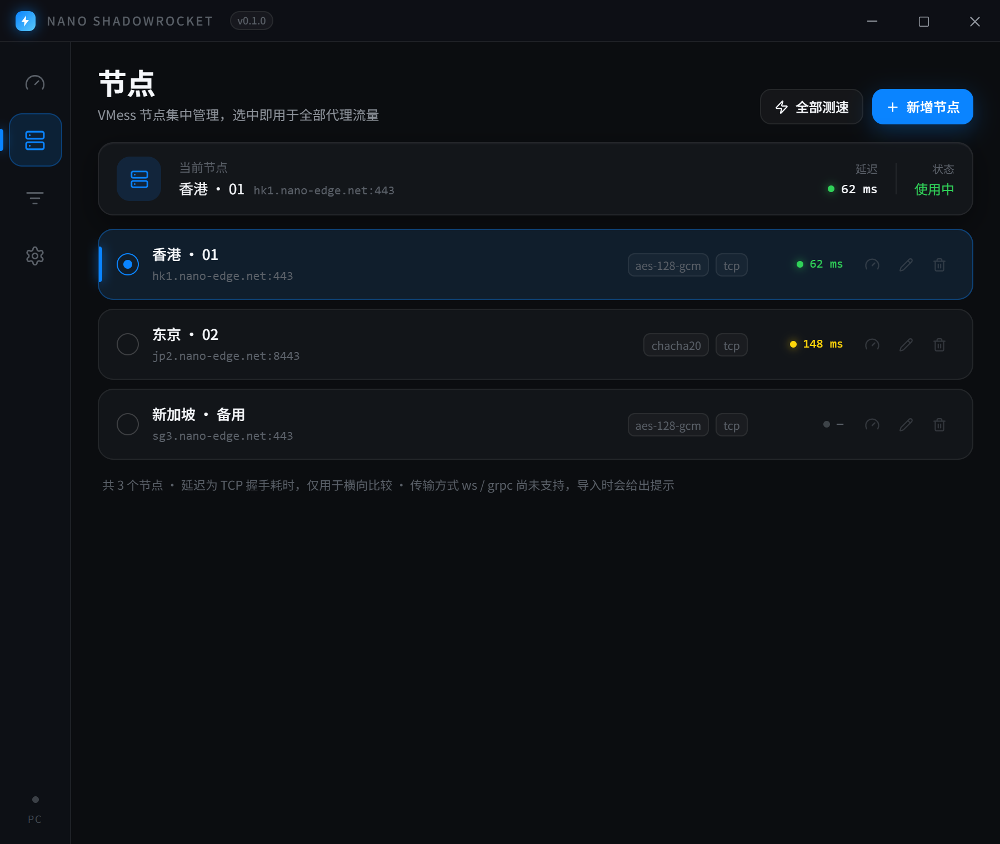
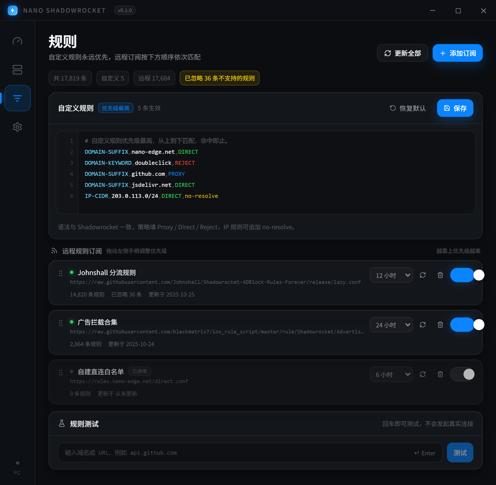
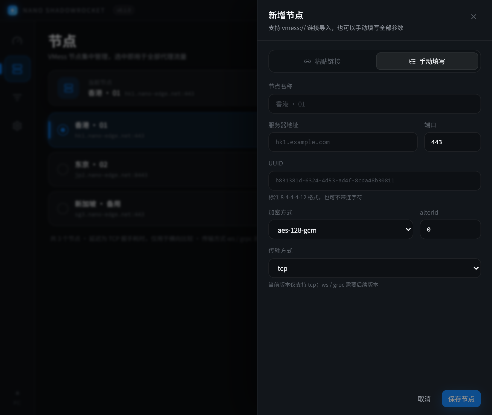
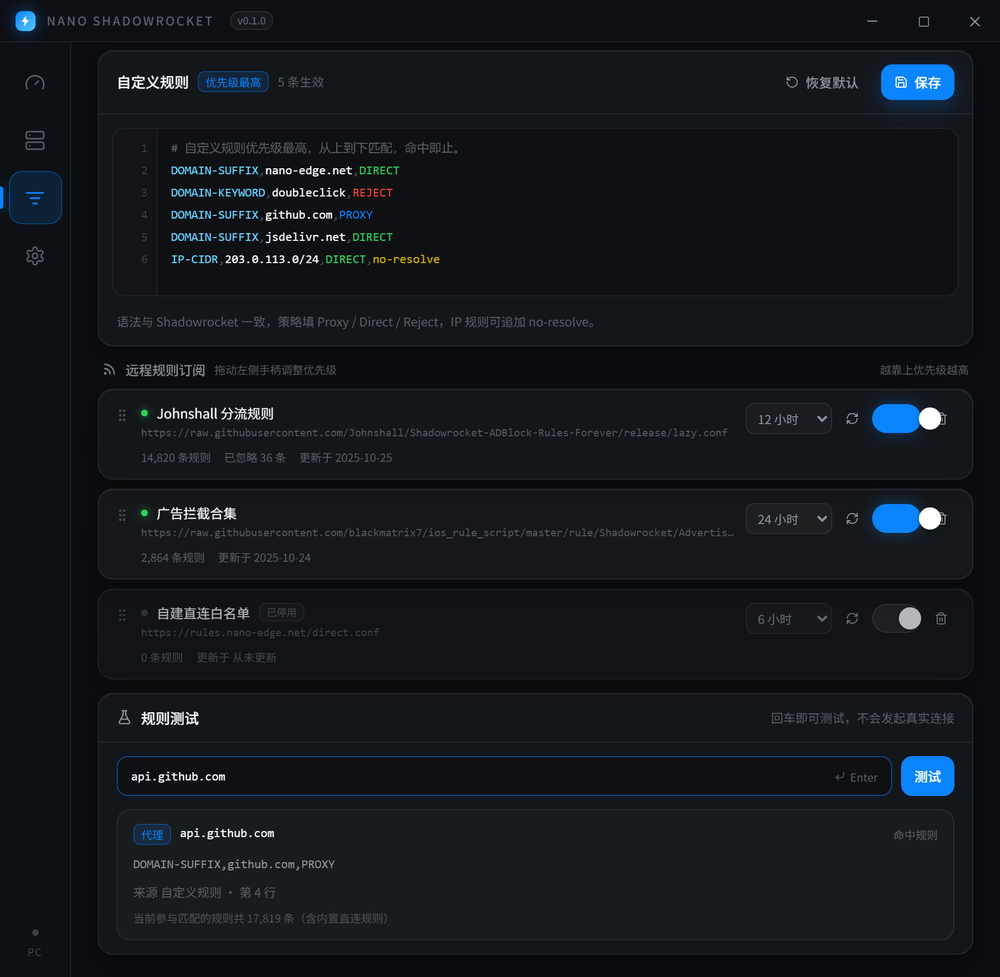
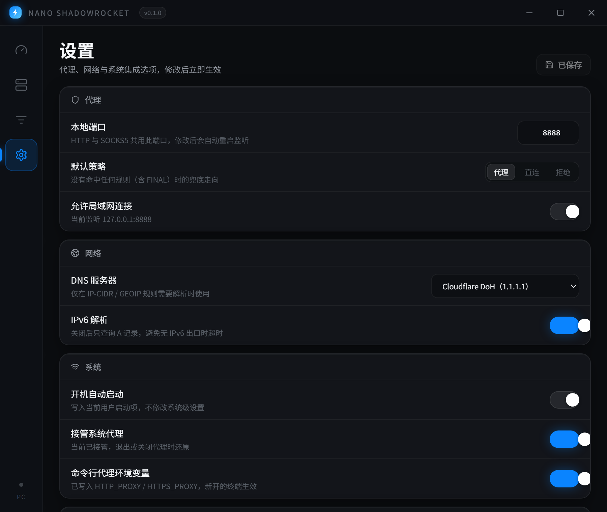

<div align="center">

# NanoShadowrocket

**极轻量的 Windows 代理客户端，交互与视觉对标 Shadowrocket。**

一个 3MB 的安装包，没有驱动、没有 TUN、没有后台服务，双击就能让流量按规则走。


[下载安装](#安装) · [快速开始](#快速开始) · [规则语法](#规则语法) · [常见问题](#常见问题) · [开发者文档](AGENTS.md)

</div>



## 特性

- **一键接管**：开启后监听 `127.0.0.1:8888`，同一个端口同时兼容 HTTP 代理与 SOCKS5。
- **系统代理托管**：开启时写入 Windows 代理设置，关闭或退出自动还原；异常退出留下的残留会在下次启动时修复。
- **命令行也能走**：可选的 `HTTP_PROXY` / `HTTPS_PROXY` 用户环境变量托管，让 `curl`、`git`、`npm` 这类不读系统代理的工具一并生效；关闭或卸载时按原值还原。
- **VMess 节点**：粘贴 `vmess://` 链接即可导入，支持 aes-128-gcm / chacha20-poly1305；节点可编辑、删除、单独测速或批量测速。
- **Shadowrocket 规则**：解析 `.conf` 的 `DOMAIN` / `DOMAIN-SUFFIX` / `DOMAIN-KEYWORD` / `IP-CIDR` / `GEOIP` / `FINAL`，策略支持 Proxy、Direct、Reject。
- **优先级可控**：自定义规则永远第一，远程订阅按拖动顺序依次匹配，最后是默认策略。
- **订阅自动更新**：多条规则 URL，6 / 12 / 24 / 48 小时或手动；带 ETag 条件请求，没变化不会重复下载。
- **规则测试器**：输入域名就知道命中哪条规则、来自哪个订阅的第几行、最终走代理还是直连。
- **托盘常驻**：关闭窗口只是隐藏，托盘菜单可以直接开关代理。

## 截图

| 节点管理 | 规则分流 |
| --- | --- |
|  |  |

| 新增 / 编辑节点 | 规则测试 |
| --- | --- |
|  |  |



## 安装

### 下载安装包

到 [Releases](../../releases) 下载 `NanoShadowrocket_x.y.z_x64-setup.exe`，双击安装即可。

系统要求：Windows 10 / 11 x64，自带 WebView2（若精简系统缺失，可从微软官网安装 Evergreen Runtime）。

### 从源码构建

需要：[bun](https://bun.sh) 1.4+、Rust 1.90+、Visual Studio Build Tools（C++ 桌面开发）、WebView2。

```bash
bun install
bun run tauri:build
```

安装包输出在 `src-tauri/target/release/bundle/nsis/`。首次编译约 8-10 分钟，之后增量打包约 1-2 分钟。

## 快速开始

### 1. 添加节点

打开左侧「节点」页，点击右上角 **新增节点**：

- **粘贴链接**：把 `vmess://...` 整段粘进输入框，400ms 后出现解析预览（名称、地址、端口、加密方式）。确认无误后点 **保存节点**。
- **手动填写**：切到「手动填写」，填写地址、端口、UUID、alterId、加密方式与传输方式。

> 传输方式目前只实现了 `tcp`。选择 `ws` / `grpc` 会看到黄色提示，保存后无法连接。

### 2. 选择节点

节点卡片左侧的圆点即选中状态，切换节点时如果代理正在运行会自动重连。右侧三个按钮分别用于测速、编辑、删除。

### 3. 配置规则（可选）

不加任何规则也能用：所有流量走代理，内网与本机地址自动直连。

- **自定义规则**：在「规则」页顶部的编辑区直接写，例如 `DOMAIN-SUFFIX,github.com,Proxy`。语法与 Shadowrocket 一致，保存后立即生效，并且永远优先于订阅。
- **远程订阅**：点击 **添加订阅**，粘贴一个 `.conf` 地址（例如 Johnshall 的分流规则合集），选择更新间隔。下载成功后会显示规则条数与更新时间。
- **调整顺序**：拖动订阅卡片左侧的 `⋮⋮` 手柄，越靠上的订阅优先级越高。

### 4. 开启代理

回到首页，点击中间的大圆形开关。开关变绿、出现光晕即表示：

- 本地 `127.0.0.1:8888` 已开始监听；
- Windows 系统代理已指向该端口（设置页可关闭这一行为）；
- 若在设置里开了「命令行代理环境变量」，新开的终端会自动带上 `HTTP_PROXY` / `HTTPS_PROXY`。

### 5. 验证是否生效

- 首页的「实时流量」出现上下行曲线，说明有流量经过；
- 「最近连接」会列出域名与命中的策略（蓝=代理、灰=直连、红=拒绝）；
- 在「规则」页底部输入 `api.github.com` 回车，可以直接看到命中的规则与最终走向。

### 6. 关闭与退出

再点一次圆形开关即可停止代理并还原系统代理。

关闭窗口只会隐藏到托盘。**真正退出**请右键任务栏托盘图标，选择「退出 NanoShadowrocket」，退出时会再次确认还原系统代理。

卸载时安装程序会先调用一次还原，把系统代理与代理环境变量恢复成安装前的值，不会留下指向已关闭端口的死代理。

## 规则语法

```text
[General]
skip-proxy = 192.168.0.0/16, localhost, *.local

[Rule]
DOMAIN,api.example.com,Proxy
DOMAIN-SUFFIX,example.com,Direct
DOMAIN-KEYWORD,doubleclick,Reject
IP-CIDR,203.0.113.0/24,Direct,no-resolve
GEOIP,CN,Direct
FINAL,Proxy
```

| 类型 | 说明 |
| --- | --- |
| `DOMAIN` | 精确匹配域名 |
| `DOMAIN-SUFFIX` | 匹配域名本身及其所有子域 |
| `DOMAIN-KEYWORD` | 域名包含关键字即命中 |
| `IP-CIDR` | 匹配目标 IP 段，可加 `no-resolve` 禁止为此规则解析域名 |
| `GEOIP` | 目前仅支持 `CN`，走内置国内网段表 |
| `FINAL` | 兜底规则，之后的规则不再参与 |

- 策略名大小写不敏感，`Allow` / `Bypass` / `Deny` 等别名会被归一化。
- 不支持的规则类型（如 `USER-AGENT`）会被跳过，并在页面顶部显示「已忽略 N 条」。
- 匹配顺序：**自定义规则 → 远程订阅（按拖动顺序）→ 内置内网直连 → FINAL → 默认策略**。

### 现成的规则集（Johnshall top500）

直接在「添加订阅」里粘贴下面的地址即可，两个规则集都已实测可用：

| 规则集 | 行为 | 规则地址 |
| --- | --- | --- |
| 黑名单 + 广告 | 只有被墙站点与广告走代理 / 拒绝，其余站点直连（文件末尾 `FINAL,direct`） | [sr_top500_banlist_ad.conf](https://johnshall.github.io/Shadowrocket-ADBlock-Rules-Forever/sr_top500_banlist_ad.conf) |
| 白名单 + 广告 | 可直连的境外站与中国站点直连，其余境外站点代理（`GEOIP,CN,DIRECT` + `FINAL,PROXY`） | [sr_top500_whitelist_ad.conf](https://johnshall.github.io/Shadowrocket-ADBlock-Rules-Forever/sr_top500_whitelist_ad.conf) |

- 黑名单版约 9.1 万条规则（其中 6.1 万条广告 Reject），首次编译约 0.4 秒；白名单版约 6.2 万条，约 0.3 秒。
- 两个文件各有一条 `RULE-SET` 外部列表，本程序暂不支持，会显示「已忽略 1 条」，只影响 Apple News 相关域名。
- 白名单版的 `GEOIP,CN` 需要解析目标 IP：未命中域名规则时才会触发 DNS（结果有缓存），DNS 失败时会退回域名规则，不会阻断连接。
- **两个规则集请二选一**：它们的 `FINAL` 语义相反，同时启用时只有排在前面那条 `FINAL` 生效。
- 规则集自带的 `[General]`（`dns-server`、`skip-proxy`）暂不生效，DNS 请在设置页配置；内网直连由程序内置规则保证。

## 常见问题

**开启后浏览器打不开网页？**

先确认节点可用（节点页点测速），再看首页最近连接里域名命中的策略。如果关键域名被 `Reject`，检查自定义规则与订阅顺序。系统代理也可能被其它代理软件改写，关闭它们后重新开启即可。

**提示端口被占用？**

`8888` 已被别的程序监听。到设置页换一个端口（例如 `7890` 或 `10808`），保存后代理会自动重启。

**订阅添加失败 / 规则是 0 条？**

规则地址需要能直接访问到 `.conf` 文本（GitHub Raw 链接在国内可能超时）。错误原因会显示在订阅卡片上，修好网络后点该卡的刷新按钮重试。

**支持 ws / tls / grpc 节点吗？**

暂不支持，当前只实现了 VMess AEAD + TCP。导入时会明确提示，不会静默失败。

**配置存在哪？怎么彻底重置？**

配置与规则缓存在 `%APPDATA%\com.nanoshadowrocket.desktop\`。也可以在设置页底部「重置全部配置」一键清空（需二次确认）。

**系统代理没还原怎么办？**

正常关闭、退出程序都会还原；如果进程被强制结束，下次启动会检测残留标记并自动修复。也可以在 Windows 设置 → 网络和 Internet → 代理 中手动关闭。

## 技术细节

架构、模块职责、命令与事件契约、测试与构建说明都在 [AGENTS.md](AGENTS.md)。

## 许可证

[MIT](LICENSE)
